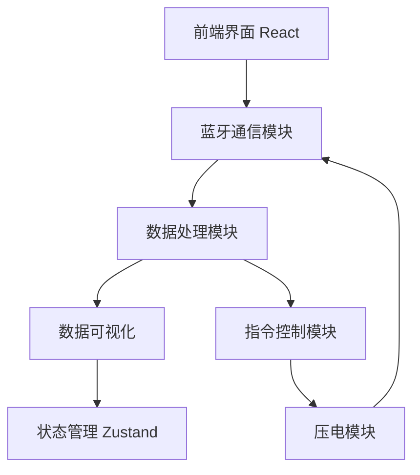

## 1. Architecture Design



## 2. Technology Description
- Frontend: React@18 + TypeScript + tailwindcss@3 + vite
- Initialization Tool: vite-init
- Backend: None (纯前端应用)
- 数据可视化: Chart.js / Canvas API
- 图标库: lucide-react
- 状态管理: zustand

## 3. Route Definitions
| Route | Purpose |
|-------|---------|
| / | 主页 - 蓝牙连接、数据可视化、指令发送 |
| /settings | 配置页面 - 参数设置 |

## 4. Data Model

### 4.1 蓝牙设备数据结构
```typescript
interface BluetoothDevice {
  id: string;
  name: string;
  rssi: number;
  connected: boolean;
}

interface SensorData {
  timestamp: number;
  value: number;
  voltage: number;
}

interface Command {
  id: string;
  name: string;
  payload: string;
  timestamp: number;
}

interface AppState {
  connectedDevice: BluetoothDevice | null;
  sensorData: SensorData[];
  commandHistory: Command[];
  isConnected: boolean;
}
```

## 5. 核心组件结构
```
src/
├── components/
│   ├── BluetoothPanel.tsx      # 蓝牙连接面板
│   ├── DataVisualization.tsx    # 数据可视化
│   ├── CommandPanel.tsx     # 指令发送面板
│   └── SettingsPanel.tsx   # 配置面板
├── pages/
│   ├── Home.tsx
│   └── Settings.tsx
├── hooks/
│   └── useBluetooth.ts      # 蓝牙通信钩子
├── utils/
│   └── dataProcessor.ts     # 数据处理工具
└── store/
    └── useAppStore.ts      # Zustand 状态管理
```
