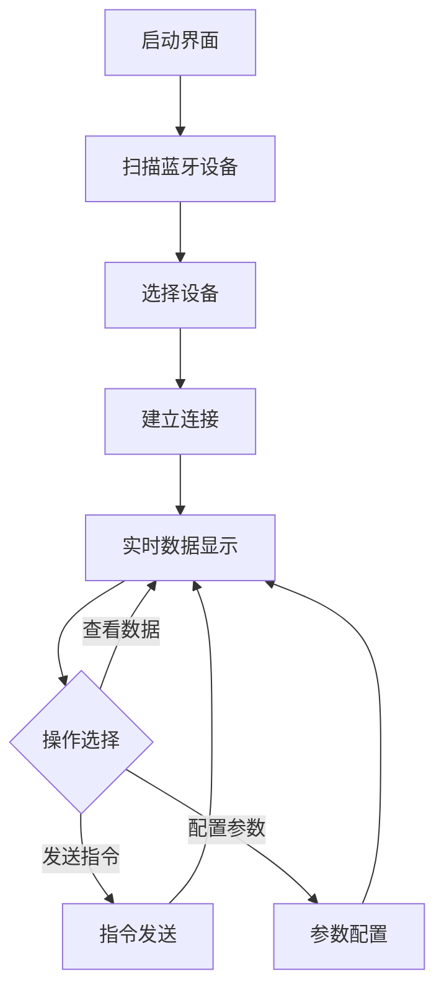

## 1. Product Overview
蓝牙与压电模块通信界面，用于医学心脏起搏导线检测与监控。
- 主要用途：实时监测心脏起搏导线压电传感器数据、发送测试指令、配置检测参数
- 目标用户：医学工程师、临床医生、设备维护人员

## 2. Core Features

### 2.2 Feature Module
1. **主页**：蓝牙连接控制、数据可视化、指令发送面板
2. **配置页面**：设备参数配置、通信协议设置

### 2.3 Page Details
| Page Name | Module Name | Feature description |
|-----------|-------------|---------------------|
| 主页 | 蓝牙连接面板 | 设备扫描、连接状态显示、信号强度指示 |
| 主页 | 数据可视化 | 实时波形图、数据表格、统计信息 |
| 主页 | 指令发送 | 预设指令按钮、自定义指令输入、发送历史 |
| 配置页面 | 参数配置 | 采样率设置、阈值配置、报警选项 |

## 3. Core Process
用户启动界面 → 扫描蓝牙设备 → 选择并连接压电模块 → 实时查看传感器数据 → 发送控制指令 → 配置设备参数

## 4. User Interface Design
### 4.1 Design Style
- 主色调：白色 (#ffffff)、医疗蓝 (#2563eb)、浅灰 (#f1f5f9)
- 按钮风格：圆角矩形、简洁专业、医疗蓝主色
- 字体：Fira Code (等宽) 用于数据显示，Inter 用于界面文本
- 布局风格：左侧导航、右侧内容区的仪表盘布局，简洁专业
- 图标风格：线性、专业医疗风格、使用 Lucide Icons

### 4.2 Page Design Overview
| Page Name | Module Name | UI Elements |
|-----------|-------------|-------------|
| 主页 | 蓝牙连接面板 | 卡片式设计、状态指示灯、信号强度条 |
| 主页 | 数据可视化 | Canvas 实时波形图、数据表格、统计卡片 |
| 主页 | 指令发送 | 网格布局按钮、输入框、历史记录列表 |
| 配置页面 | 参数配置 | 表单布局、滑块、开关控件、保存按钮 |

### 4.3 Responsiveness
桌面端优先，支持自适应布局，关键组件在小屏幕上可堆叠显示。

### 4.4 数据可视化风格
- 波形图使用渐变色彩
- 数据点有悬停高亮效果
- 支持缩放和平移操作
- 实时更新动画平滑流畅
